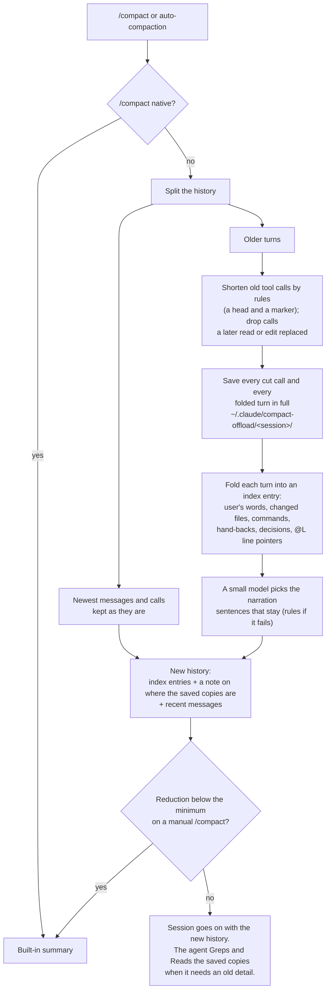

# verbatim-compact

**Verbatim compaction for Claude Code sessions.** 
Old turns are folded into an index and saved to disk, so the agent keeps the real history instead of a summary of it.

Needs Claude Code <b>2.1.287 or later</b>: the plugin is a <a href="https://code.claude.com/docs/en/plugins/mods/overview">mod</a>, which is on by default from that version. Older versions need <code>CLAUDE_CODE_ENABLE_FUNCTION_HOOKS=1</code>, the early-access switch for mods.

## Why verbatim-compact

- **No retold history.** The built-in `/compact` replaces the conversation with a model's summary. verbatim-compact keeps the newest calls as they are and folds each older turn into an index entry: your words, changed files, commands, decisions and hand-backs.
- **Nothing is lost.** The full text of every folded turn is saved in the session folder, and the index entry points at its lines, so the agent reads back only the part it needs.
- **No summary model by default.** Folding runs on rules; a small model only picks which narration sentences stay.

## How it works

## Quick start

    /plugin marketplace add PetukhovArt/verbatim-compact
    /plugin install verbatim-compact@verbatim-compact

Nothing else to set: `/compact` and auto-compaction now go through the plugin, and `/compact native` still gives the built-in summary. `/plugin` shows "1 mod active" when it is loaded.

Works in the CLI, the JetBrains plugin, the Desktop Code tab (not in WSL or SSH sessions) and the VS Code extension. Like every mod, it runs inside Claude Code with your permissions: read [`plugin/hooks/claude-compact.ts`](plugin/hooks/claude-compact.ts) before you install it. `disableAllHooks` or the managed setting `allowManagedModsOnly` turn it off.

<b>Options</b>

Set them in `/plugin` → verbatim-compact → configure.

| Option | Default | What it does |
|---|---|---|
| `preserveRecentMessages` | 6 | Newest messages that are never compacted |
| `keepImages` | 3 | Newest image results that stay; older ones become a one-line marker. -1 keeps all |
| `minReductionRatio` | 0.25 | Below this reduction a manual `/compact` falls back to the built-in summary |
| `strategy` | `tiers` | `tiers` cuts calls by age; `source` cuts only calls whose content can be read or rerun again |
| `scoring` | `none` | `blind` or `content`: a model also scores which calls to keep, at the cost of requests on every compaction |

<b>Release</b>

    node scripts/release.mjs patch|minor|major
    git push origin main

The script moves `## Unreleased` in `CHANGELOG.md` to the new version and bumps `plugin/.claude-plugin/plugin.json`. On push, the Release workflow runs the tests, tags `vX.Y.Z`, writes the GitHub release from the changelog and moves the `live` branch to the release.

## Docs

[Changelog](CHANGELOG.md)

MIT © Artem Petukhov
